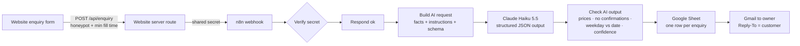
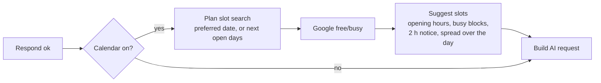

# AI Booking Assistant (website enquiries → triage → owner)

An AI assistant that handles booking enquiries from a small business's website, built for and running at a real South African beauty salon (the client is anonymised here). A customer fills in the website's enquiry form. Within seconds the owner gets an email with the enquiry already sorted and a suggested reply drafted from the salon's own prices and policies, and every enquiry is logged to a Google Sheet. A person always sends the actual reply.

**Portfolio angle:** implementation work end to end. That covers discovery with a real business, replacing a third-party form, integrating Claude, Google and n8n, guardrails that check the AI instead of trusting it, POPIA-aware data handling, and hosting it for $0 a month.

## How it works



1. **Website** (Astro 7 + Keystatic, on Vercel): a custom form replaced the old Jotform embed. The `/api/enquiry` route validates the input. It drops spam silently (a hidden honeypot field, and forms submitted faster than a person could), then forwards the enquiry with a shared secret.
2. **n8n workflow**, generated from code (`scripts/build_workflow.py` → `n8n/enquiry-intake.json`), so the build is versioned and reviewable:
   - **Claude Haiku 5.5** classifies the intent (booking, price question, course, party, reschedule or cancel, complaint, other), pulls out services, date and urgency, and drafts a reply. It returns schema-validated JSON.
   - The **knowledge base** is built from the salon website's own content files (`scripts/build_knowledge.py`). When the owner changes a price in the site's admin, rebuilding keeps the assistant in sync. There is one source of truth.
   - **Guardrails in code, not in the prompt.** Every price in the draft must appear in the price list. A draft that confirms a booking is flagged. A weekday that doesn't match the chosen date is flagged. Low confidence goes to the owner. Complaints, refunds, reschedules, medical or allergy questions, and party or course bookings always go to the owner.
   - **Prompt injection:** the enquiry text is passed as data inside tags, and the checks above run on the output whatever the prompt said.
3. **Google**, through one OAuth credential with least-privilege scopes: `gmail.send` (send-only; it can't read mail), `spreadsheets`, and `calendar.freebusy` (busy/free times only, for v2 slot suggestions). n8n's default Gmail scope asks for full mailbox access, so it was replaced.

## Evaluation

56 labelled enquiries ([`eval/cases.jsonl`](eval/cases.jsonl)), labelled by written rules ([`eval/LABELING.md`](eval/LABELING.md)) and split into **dev** (24, used to fix the prompt) and **test** (32, scored once, never tuned on). The runner ([`eval/run.mjs`](eval/run.mjs)) executes **the production n8n code itself** (the build-request and guardrail Code nodes, exported by `build_workflow.py --eval-bundle`) against the fictional Example Salon, so the score is for what's deployed, not a copy.

| Metric (held-out test, n=32) | Result |
|---|---|
| **Escalation recall**: enquiries that must reach the owner and did | **100% (20/20)** |
| …from the AI alone, before the code guardrails | 95% (19/20): the guardrails caught the rest |
| Drafts that confirm a booking | **0** |
| Prices that had to be quoted, quoted exactly | 100% (4/4) |
| Intent accuracy (7 classes) | 93.8% (30/32) |
| Over-escalation (owner bothered when the draft was fine) | 8.3% (1/12), down from 16.7% after the price-check fix |
| Cost per enquiry | **$0.00042** |
| AI latency p50 / p95 | 2.3 s / 4.8 s |

**What dev taught us** (reports in [`eval/results/`](eval/results/)):
- The first prompt listed intent names without defining them, which cost 2 intent misses. Its "availability isn't in the facts, so escalate" rule escalated a harmless Sunday request.
- Narrowing that rule fixed over-escalation but **dropped escalation recall to 87.5%**: "please call me" and a prompt-injection message slipped through, because the old over-broad rule had been catching them by accident. Naming both explicitly in the escalation list brought dev to 24/24. This is exactly why the eval exists.

**Price guardrail, round two:** the first version accepted only prices printed on the menu, so a correctly calculated total ("R450 + R20 = R470") was flagged and caused most of the over-escalation. It now also accepts multiples of a per-unit price that the draft itself quotes ("R10 per nail", so R100 for ten nails), and totals of 2 to 4 verified prices (R1 600 + 2 × R350 = R2 300). Hallucinated, customer-claimed and miscalculated prices are still caught: 17 deterministic unit tests ([`eval/check.test.mjs`](eval/check.test.mjs)) cover both sides. Because the change is in code, not the model, `run.mjs --rescore` replays the saved AI outputs through the new check for free. On the held-out test that took over-escalation from 16.7% to 8.3%, with escalation recall unchanged at 100%. Three new dev cases with real arithmetic drafts all pass.

Earlier live checks on the real deployment: a package price quoted correctly with the deposit terms, a prompt-injection message resisted, a complaint routed to the owner, and a "Friday" request with a Saturday date caught. End to end (form to email) takes 6–18 s on the 1 GB free-tier VM.

## Calendar slot suggestions (v2, off until the salon shares its calendar)

When `CALENDAR_ID` is set, the workflow branches after accepting the form:



- **Least privilege:** the scope is `calendar.freebusy`, which sees busy and free times only, never event titles or guests. It replaced the unused `calendar.events`, so the app now asks for *less*. Google classes it as non-sensitive. The salon only has to share its calendar as "free/busy".
- **The AI may offer the suggested times but never reserve them.** If the customer's own time is taken, it says so and offers the free ones.
- **Time guardrail in code:** any time in the draft that isn't an offered slot, an opening or closing time from the facts, or the customer's own words is flagged and sent to the owner. The AI can't invent availability.
- **Fails safe:** if the calendar call fails, the enquiry carries on without suggestions.
- **Tests:**
  - 13 unit tests for the slot maths ([`eval/slots.test.mjs`](eval/slots.test.mjs));
  - 26 for the guardrails, including the time check ([`eval/check.test.mjs`](eval/check.test.mjs));
  - 4 dev eval cases with slots: all 4 offered a real slot, 0 drafts mentioned an un-offered time;
  - a re-score of all 56 earlier drafts: the new time check added no false flags.
- **Demo:** run end to end on local n8n against a demo calendar with a 08:00–11:00 booking. A Saturday 9am request came back with "9am doesn't look free, but 11:00, 12:00 or 13:00 are open".

## Hosting ($0/month)

| Piece | Where | Cost |
|---|---|---|
| Website + form route | Vercel (Hobby) | Free |
| n8n + HTTPS | Oracle Cloud Always Free VM (Johannesburg), Docker + Caddy (Let's Encrypt), [`deploy/`](deploy/README.md) | Free |
| AI | Anthropic API | ~$0.0004 per enquiry (measured) |
| Log + notifications | The operator's Google Sheet and Gmail | Free |

`scripts/deploy.sh <ip>` provisions the VM (Docker, swap, firewall), imports the workflow and credential **with n8n stopped**, and starts n8n behind Caddy. [`deploy/README.md`](deploy/README.md) lists the gotchas found the hard way.

## Run it yourself

```bash
cp client.env.example client.env      # business name, description, website content folder, contact
cp .env.example .env                  # API key, webhook secret, Google OAuth client, Sheet id (never committed)
scripts/n8n.sh knowledge              # build knowledge/<slug>.md from the website's content
scripts/n8n.sh import && scripts/n8n.sh start
```

Without a `client.env`, everything falls back to a fictional "Example Salon" ([`knowledge/example.md`](knowledge/example.md)). Client-specific files (`client.env`, `knowledge/<slug>.md`, the generated workflow JSON) are gitignored.

## Privacy (POPIA)

The customer's consent is captured on the form. Data goes only to the operator's Sheet and inbox and to the AI provider. Run history on the server is pruned after 30 days. Access and deletion requests are handled within 7 days. See [`compliance/popia.md`](compliance/popia.md) and the public privacy page template in [`deploy/site/`](deploy/site/).

## Roadmap

- **v2:** turn on slot suggestions for the live salon once the owner shares her calendar's free/busy (built and tested, see above).
- **WhatsApp channel** through the business's own Meta account. This was the original plan ([REQUIREMENTS.md](REQUIREMENTS.md), [`whatsapp-templates/`](whatsapp-templates/)) and was paused because Meta restricted the developer's own profile, which is why the website-form channel came first.
