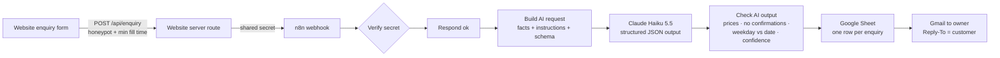

# AI Booking Assistant (website enquiries → triage → owner)

An AI assistant that handles booking enquiries from a small business's website, built for and running at a real South African beauty salon (the client is anonymised here). A customer fills in the website's enquiry form. Within seconds the owner gets an email with the enquiry already sorted and a suggested reply drafted from the salon's own prices and policies, and every enquiry is logged to a Google Sheet. A person always sends the actual reply.

**Portfolio angle:** implementation work end to end. That covers discovery with a real business, replacing a third-party form, integrating Claude, Google and n8n, guardrails that check the AI instead of trusting it, POPIA-aware data handling, and hosting it for $0 a month.

## How it works



1. **Website** (Astro 7 + Keystatic, on Vercel): a custom form replaced the old Jotform embed. The `/api/enquiry` route validates the input. It drops spam silently (a hidden honeypot field, and forms submitted faster than a person could), then forwards the enquiry with a shared secret.
2. **n8n workflow**, generated from code (`scripts/build_workflow.py` → `n8n/enquiry-intake.json`), so the build is versioned and reviewable:
   - **Claude Haiku 5.5** classifies the intent (booking, price question, course, party, reschedule or cancel, complaint, other), pulls out services, date and urgency, and drafts a reply. It returns schema-validated JSON.
   - The **knowledge base** is built from the salon website's own content files (`scripts/build_knowledge.py`). When the owner changes a price in the site's admin, rebuilding keeps the assistant in sync. There is one source of truth.
   - **Guardrails in code, not in the prompt.** Every price in the draft must appear in the price list. A draft that confirms a booking is flagged. A weekday that doesn't match the chosen date is flagged. Low confidence goes to the owner. Complaints, refunds, reschedules, medical or allergy questions, and party or course bookings always go to the owner.
   - **Prompt injection:** the enquiry text is passed as data inside tags, and the checks above run on the output whatever the prompt said.
3. **Google**, through one OAuth credential with least-privilege scopes: `gmail.send` (send-only; it can't read mail), `spreadsheets`, and `calendar.events` (reserved for v2). n8n's default Gmail scope asks for full mailbox access, so it was replaced.

## Results (real runs)

| Check | Result |
|---|---|
| Cost per enquiry | ~$0.001 (Claude Haiku 5.5, low effort) |
| End to end (form → email) | 6–18 s on a 1 GB free-tier VM |
| Package price quoted | Correct to the rand, deposit terms matched the salon's T&Cs |
| Prompt injection in the message ("ignore your instructions…") | Resisted; normal triage |
| Complaint | Routed to the owner (`needs_owner`, high urgency) |
| "Friday" with a date that is a Saturday | Caught by the weekday check and flagged for the owner |

## Hosting ($0/month)

| Piece | Where | Cost |
|---|---|---|
| Website + form route | Vercel (Hobby) | Free |
| n8n + HTTPS | Oracle Cloud Always Free VM (Johannesburg), Docker + Caddy (Let's Encrypt), [`deploy/`](deploy/README.md) | Free |
| AI | Anthropic API | ~$0.001 per enquiry |
| Log + notifications | The operator's Google Sheet and Gmail | Free |

`scripts/deploy.sh <ip>` provisions the VM (Docker, swap, firewall), imports the workflow and credential **with n8n stopped**, and starts n8n behind Caddy. [`deploy/README.md`](deploy/README.md) lists the gotchas found the hard way.

## Run it yourself

```bash
cp client.env.example client.env      # business name, description, website content folder, contact
cp .env.example .env                  # API key, webhook secret, Google OAuth client, Sheet id (never committed)
scripts/n8n.sh knowledge              # build knowledge/<slug>.md from the website's content
scripts/n8n.sh import && scripts/n8n.sh start
```

Without a `client.env`, everything falls back to a fictional "Example Salon" ([`knowledge/example.md`](knowledge/example.md)). Client-specific files (`client.env`, `knowledge/<slug>.md`, the generated workflow JSON) are gitignored.

## Privacy (POPIA)

The customer's consent is captured on the form. Data goes only to the operator's Sheet and inbox and to the AI provider. Run history on the server is pruned after 30 days. Access and deletion requests are handled within 7 days. See [`compliance/popia.md`](compliance/popia.md) and the public privacy page template in [`deploy/site/`](deploy/site/).

## Roadmap

- **v2:** offer free slots from Google Calendar in the draft reply (the scope is already granted).
- **WhatsApp channel** through the business's own Meta account. This was the original plan ([REQUIREMENTS.md](REQUIREMENTS.md), [`whatsapp-templates/`](whatsapp-templates/)) and was paused because Meta restricted the developer's own profile, which is why the website-form channel came first.
- An eval set of 50+ labelled enquiries, as in [ai-support-triage](https://github.com/mmoshabe/ai-support-triage).
